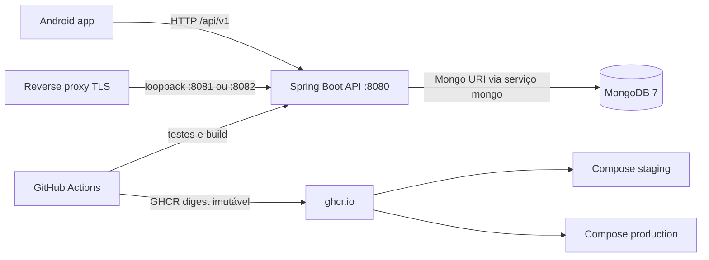

# ÁguiaBranca | CI/CD, Docker e Operação

**Integrantes:** [preencher nomes]  
**Turma:** [preencher]  
**Data:** [preencher]

> Documento-fonte em Markdown para exportação a PDF. Evidências de execução devem ser inseridas somente após execuções reais; os campos pendentes abaixo não representam resultados.

## 1. Arquitetura

O sistema contém um cliente Android e uma API Spring Boot. O cliente Android é compilado/testado no CI, mas não é um serviço de runtime Docker. A API é empacotada em uma imagem multi-stage Java 21 e persiste dados em MongoDB 7.



| Componente | Tecnologia | Finalidade |
|---|---|---|
| App | Kotlin, Jetpack Compose, Gradle 9.3.1, AGP 9.1.1 | Cliente Android, testes unitários e APK debug no CI. |
| API | Java 21, Spring Boot 3.4.13, Maven | REST, autenticação JWT, regras de domínio e Actuator. |
| Banco | MongoDB 7 | Persistência; URI externa via `MONGODB_URI`. |
| Container | Docker multi-stage, Compose v2 | Compilar API, executar com usuário não privilegiado, saúde e persistência. |
| CI/Registry | GitHub Actions, GHCR | Validar código e armazenar imagem por digest. |

## 2. Containerização

`backend/Dockerfile` usa Maven + Temurin 21 para cache de dependências e empacotamento; a imagem runtime usa Temurin JRE 21, `curl` para o healthcheck, usuário UID/GID 10001 e porta 8080. O contexto é a raiz do repositório, controlado por `.dockerignore`; arquivos `.env` não são copiados.

`compose.yaml` é para desenvolvimento local. O MongoDB tem volume persistente e porta publicada somente em loopback. Staging e produção usam Compose separado, MongoDB autenticado sem porta host, nomes explícitos de projeto/rede/volume, banco e credenciais distintos. As APIs ficam em loopback para serem expostas por um reverse proxy TLS administrado pela infraestrutura.

A API lê `MONGODB_URI` e `MONGODB_DATABASE` de variáveis Spring. Em todos os containers de ambiente a URI usa `mongo` como hostname do serviço; `localhost` é reservado ao modo local fora do Compose.

## 3. CI e publicação

`.github/workflows/ci.yml` é acionado em pull requests e pushes a `main`/`master`, além de tags `v*.*.*`.

1. O job backend configura Temurin 21/cache Maven e roda `mvn -B -f backend/pom.xml clean verify`. O conjunto inclui testes unitários e integrações Testcontainers; o runner Ubuntu fornece Docker. Surefire reports são preservados como artefato mesmo se os testes falharem.
2. O job Android configura JDK 21, Android SDK e cache Gradle; roda `:app:testDebugUnitTest` e `:app:assembleDebug`, publicando relatórios e APK debug.
3. Após ambos os jobs passarem, pushes (não pull requests) publicam a imagem da API no GHCR com tag associada ao SHA. O output do build é convertido em `ghcr.io/<owner>/<repo>@sha256:<digest>` e esse valor exato é usado nos deploys.
4. Push em `main`/`master` aciona staging quando `STAGING_DEPLOY_ENABLED=true`. Push de tag `vX.Y.Z` aciona o GitHub Environment `production`, onde deve ser exigida aprovação manual.

Permissões do token no job de publicação: `contents: read` e `packages: write`. O token `GITHUB_TOKEN` faz push; não há credencial de registry fixa no código.

## 4. Deploy e ambientes

O workflow reutilizável `.github/workflows/deploy-environment.yml` chama `scripts/deploy-ssh.sh`. O script valida o digest e o diretório remoto, usa `known_hosts` fornecido pelo Environment com verificação estrita, copia o Compose e o arquivo de ambiente por SSH, autentica no GHCR quando privado, atualiza a stack e aguarda o health endpoint por até 150 segundos. Em falha, coleta logs recentes dos serviços sem imprimir os secrets.

Staging e produção precisam de diretórios de deploy e GitHub Environments independentes. Os nomes Compose, redes, bancos e volumes são separados. A API não é publicada em endereço externo; reverse proxy, TLS, DNS, regras de firewall, backup/restore e monitoramento do host são responsabilidades da infraestrutura.

### Configuração no GitHub

Crie GitHub Environments chamados `staging` e `production`; habilite required reviewers em production. Em cada Environment, cadastre secrets próprios:

| Secret | Valor necessário |
|---|---|
| `DEPLOY_HOST` | Host Linux real, sem protocolo. |
| `DEPLOY_USER` | Usuário SSH de deploy. |
| `DEPLOY_DIRECTORY` | Caminho absoluto, distinto por ambiente. |
| `DEPLOY_SSH_PRIVATE_KEY` | Chave privada exclusiva do workflow. |
| `DEPLOY_KNOWN_HOSTS` | Fingerprint/linha `known_hosts` obtida e conferida por canal confiável. |
| `DEPLOY_ENV_FILE` | Conteúdo do `.env` daquele ambiente, baseado nos exemplos versionados. |
| `GHCR_USERNAME` | Usuário com acesso de leitura ao package. |
| `GHCR_READ_TOKEN` | PAT com `read:packages`, apenas se GHCR for privado. |

Crie variável de repositório `STAGING_DEPLOY_ENABLED=true` apenas após provisionar staging. Para produção, configure a aprovação no Environment e publique uma tag versionada, por exemplo `v1.0.0`. `JWT_SECRET`, senha do Mongo e chave Gemini devem ser distintas por ambiente; as senhas Mongo devem ser URL-safe para uso no URI.

O conteúdo dos `.env` deve ser carregado como secret `DEPLOY_ENV_FILE`, não commitado. Também são necessários Docker Engine/Compose, `curl`, SSH acessível e acesso de saída ao GHCR. Nenhum host, segredo, deploy ou aprovação foi presumido neste documento.

## 5. Comandos operacionais

Desenvolvimento, na raiz do repositório:

```powershell
Copy-Item backend/.env.example backend/.env
docker compose up --build -d
docker compose ps
docker compose logs -f api mongo
Invoke-RestMethod http://localhost:8080/actuator/health
```

Build/testes locais:

```powershell
mvn -B -f backend/pom.xml clean verify
./gradlew :app:testDebugUnitTest :app:assembleDebug
docker build -f backend/Dockerfile -t aguiabranca-api:local .
```

Windows usa `gradlew.bat`. O backend não tem Maven Wrapper; Maven 3.9+ deve estar instalado. Para validar configurações Compose:

```powershell
docker compose config --no-env-resolution --quiet
docker compose --env-file .env.staging -f compose.staging.yaml config --quiet
docker compose --env-file .env.production -f compose.production.yaml config --quiet
```

Antes dos dois últimos comandos, crie arquivos locais a partir dos exemplos e preencha valores próprios. Os arquivos reais permanecem ignorados pelo Git.

## 6. Evidências reais

Não há prints nem resultados simulados neste relatório. Preencher após executar as etapas:

| Evidência | Registro a inserir |
|---|---|
| Execução dos testes/build local ou CI | **PENDENTE** — URL da execução, commit e resultado dos jobs. |
| Relatórios Surefire e Android | **PENDENTE** — anexar artefatos baixados da execução. |
| Digest GHCR publicado | **PENDENTE** — digest e página do package. |
| Staging | **PENDENTE** — ID do deploy, `docker compose ps` e resposta real de `/actuator/health`. |
| Produção | **PENDENTE** — tag, aprovação do Environment, digest e healthcheck real. |

Não anexar logs contendo tokens, JWT, senhas, e-mails reais ou valores de `.env`.

## 7. Validação deste workspace e limitações

| Verificação | Resultado observado |
|---|---|
| Estrutura, versões e testes existentes | API Java 21/Spring Boot 3.4.13/Maven; app Gradle; testes backend e Testcontainers encontrados. |
| Compose local, staging e produção | Configuração validada com Docker Compose 5.0.2 e arquivos de exemplo. |
| `git diff --check` | Executado; registrar o resultado final após a edição documental. |
| Build da imagem | **Bloqueado**: Docker Desktop daemon indisponível neste host. |
| Build/testes Maven | **Bloqueado**: Maven não instalado neste host. |
| Workflows GitHub / GHCR | **Não executados** neste workspace; requerem push para GitHub Actions. |
| Deploy staging/produção | **Não executados**; requerem hosts, secrets e aprovação/configuração dos Environments. |
| PDF | Fonte Markdown pronta para exportação; inserir nomes/evidências e exportar após validação real. |

## 8. Checklist final

- [ ] Projeto compactado em ZIP com estrutura organizada.
- [ ] Dockerfile funcional e imagem construída.
- [x] Docker Compose ou configuração Kubernetes.
- [x] Volumes, redes e variáveis de ambiente configurados.
- [x] Pipeline com build automático.
- [x] Testes automatizados executados no pipeline (execução GitHub ainda pendente).
- [ ] Imagem Docker construída e publicada, quando a infraestrutura permitir.
- [ ] Deploy em staging realizado e validado.
- [ ] Deploy em produção realizado e validado.
- [x] README com instruções e orientação de evidências.
- [x] Documentação técnica preparada em Markdown para gerar PDF, com campos de evidência.
- [x] Segredos removidos dos arquivos versionados; `.env` ignorado.